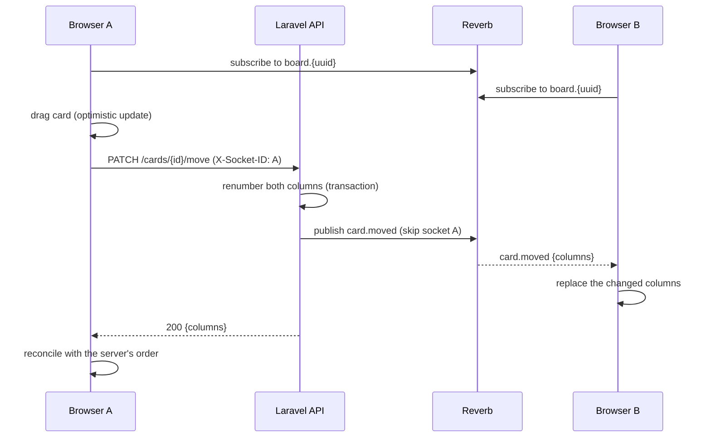

# Realtime Kanban Board

[](https://github.com/carloschnouda1/realtime-kanban-board/actions/workflows/ci.yml)
[](LICENSE)

A live, multi-user Kanban board. Open the same board in two tabs, drag a card in one, and it moves in the other without a refresh.

**Laravel 13 + Reverb** (first-party WebSockets, no third-party service) on the backend, **Next.js 14 + dnd-kit** on the frontend.

Boards have no accounts. Creating one gives you an unguessable UUID link; anyone with the link can edit the board live. That keeps the demo frictionless while still exercising the hard parts: WebSocket broadcasting, optimistic UI updates and keeping card order consistent across clients.

## Run it

You need Docker. Nothing else.

```bash
git clone https://github.com/carloschnouda1/realtime-kanban-board.git
cd realtime-kanban-board
docker compose up --build
```

| Service | URL | What it is |
|---------|-----|------------|
| web | http://localhost:3000 | Next.js app |
| api | http://localhost:8000/api | Laravel REST API |
| reverb | ws://localhost:8080 | Laravel Reverb WebSocket server |

Open http://localhost:3000, create a board, then open the board URL in a second tab (or send it to someone on your network) and drag cards around.

The keys in `docker-compose.yml` are throwaway local values. Override `REVERB_APP_KEY`, `REVERB_APP_SECRET` and `FRONTEND_URL` for anything that isn't your own machine.

## How it works



1. A board has columns (`To Do`, `In Progress`, `Done` by default) holding cards.
2. Every change goes through the REST API, which saves it and broadcasts an event on the public channel `board.{uuid}`.
3. The Next.js client subscribes with `laravel-echo` and merges incoming events into its state.
4. Dragging uses `@dnd-kit`: the UI updates immediately, then the API call persists the move and the server's answer wins.

### Design decisions worth reading

- **Moves send whole columns, not deltas.** Moving a card renumbers its neighbours. Replaying that on every client invites drift, so `card.moved` carries the complete card list of each column that changed and clients replace those columns (`web/lib/board-state.ts`). The logic lives in `CardController::move` and is covered by tests for same-column, cross-column, empty-column and out-of-range moves.
- **The sender isn't echoed.** The client sends its Reverb socket id in `X-Socket-ID`, so Laravel's `broadcast(...)->toOthers()` skips it. Without that header the creator of a column received their own event and saw it twice.
- **No queue worker.** Events implement `ShouldBroadcastNow`, so the API publishes to Reverb inside the request. One less process to run for a small app; the trade-off is that a slow Reverb slows the response.
- **Cross-board moves are rejected.** A card can only move to a column of its own board (`422`), so a leaked column id can't be used to push cards into someone else's board.
- **Public channels.** Access control is the unguessable UUID. There is no auth, which is why the API is rate limited (120 requests/minute per IP) and the WebSocket origin allow-list is configurable.

## API

| Method | Path | Description |
|--------|------|-------------|
| POST | `/api/boards` | Create a board with the three default columns |
| GET | `/api/boards/{uuid}` | Board with ordered columns and cards |
| POST | `/api/boards/{uuid}/columns` | Add a column |
| POST | `/api/columns/{id}/cards` | Add a card (appended to the column) |
| PATCH | `/api/cards/{id}` | Edit title or description |
| PATCH | `/api/cards/{id}/move` | Move to `board_column_id` at `position` |
| DELETE | `/api/cards/{id}` | Delete a card |

Events on `board.{uuid}`: `card.created`, `card.updated`, `card.moved`, `card.deleted`, `column.created`.

## Development

Run the pieces without Docker (PHP 8.3+, Composer, Node 20+):

```bash
# API
cd api
composer install
cp .env.example .env && php artisan key:generate
touch database/database.sqlite && php artisan migrate
php artisan serve            # http://localhost:8000
php artisan reverb:start     # ws://localhost:8080 (second terminal)
php artisan db:seed          # optional: a demo board

# Web
cd web
cp .env.local.example .env.local   # NEXT_PUBLIC_REVERB_APP_KEY must match the API's REVERB_APP_KEY
npm install
npm run dev                  # http://localhost:3000
```

### Tests

```bash
cd api && php artisan test       # feature tests: boards, columns, cards, move ordering, broadcasts
cd web && npm run typecheck && npm test
cd web && npm run e2e            # needs the docker compose stack running
```

CI (`.github/workflows/ci.yml`) runs on every push and pull request:

- **API:** Pint code style and the PHPUnit suite on PHP 8.3 and 8.4
- **Web:** typecheck, Vitest, production build
- **End-to-end:** builds the real stack with `docker compose`, subscribes to a board over a WebSocket like a browser, makes changes through the API and asserts that `card.created`, `card.moved` and `card.deleted` arrive

## Project layout

```
api/                 Laravel 13 app (REST API + Reverb)
  app/Events/        Broadcast events
  app/Http/          Controllers and API resources
  tests/Feature/     API and broadcast tests
web/                 Next.js app
  components/        Board, Column, Card
  lib/               API client, Echo setup, board state helpers
  scripts/e2e.mjs    WebSocket end-to-end check
docker-compose.yml   api + reverb + web
```

## Scope

This is a focused demo, not a product: no accounts, no column reordering or renaming, and SQLite as the database. Moving to Postgres, adding auth for private boards and scaling Reverb across servers (`REVERB_SCALING_ENABLED` with Redis) are the natural next steps.

## License

MIT
